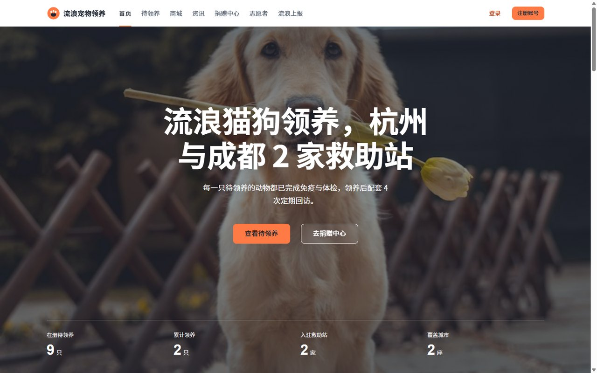
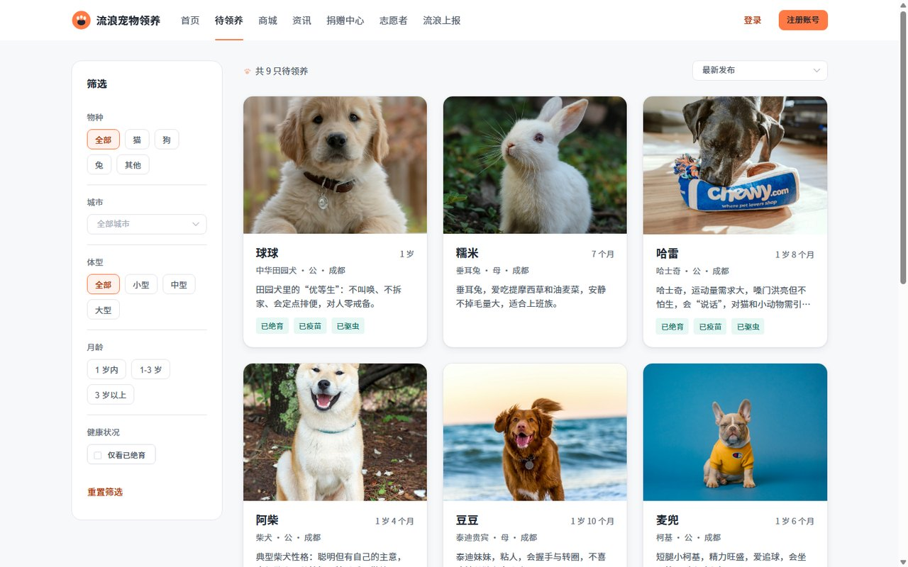
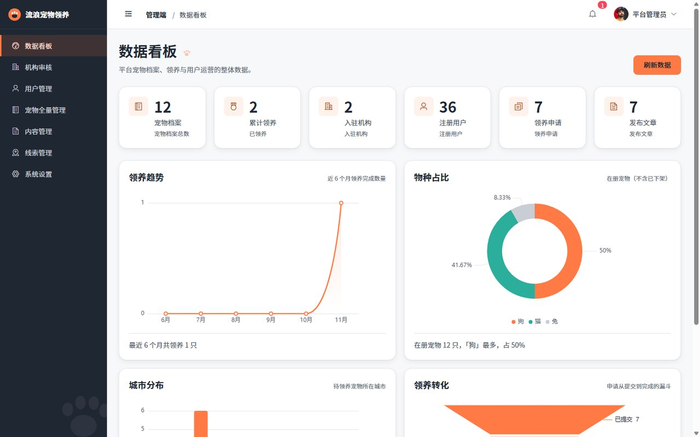

# 流浪宠物领养系统 · wandering-pet

> 连接「流浪动物救助机构」与「潜在领养人」的公益平台：宠物建档 → 领养申请 → 面谈/家访 → 签约 → 回访全流程线上可查，另含资讯科普、捐赠公示、志愿者、流浪动物线索上报、宠物用品商城与 AI 宠物顾问。

[](https://github.com/2yywhzfgj8-jpg/wandering-pet/actions/workflows/ci.yml)


## 界面预览

| 门户首页 | 待领养列表 |
| :---: | :---: |
|  |  |

| 管理端数据看板 |
| :---: |
|  |

## 项目简介

流浪动物救助长期存在三个断点：**救助站靠表格和微信群记录宠物，信息分散**、**领养申请靠口头沟通，流程不可追溯**、**领养后缺少回访，退养与虐待难以及时发现**。本项目把这三点搬到线上：

- 结构化的**宠物档案**（健康档案、绝育/疫苗/驱虫、相册、上下架状态）替代零散表格；
- **7 状态领养状态机** + 全流程流水 + 站内信通知，谁审到哪一步一目了然；
- 领养完成自动生成 **7 / 30 / 90 / 180 天回访任务**，逾期自动标红。

系统包含 **Web 三端（用户端 / 机构端 / 管理端，共 30 个页面）与微信小程序（23 个页面）**，共用一套后端接口（32 个 Controller、160+ REST 接口）。

## 功能特性

| 模块 | 能力 |
| --- | --- |
| 宠物档案 | 分类/品种、健康档案、相册、上下架、浏览量、收藏 |
| 领养 | 申请表单、`提交 → 审核 → 面谈 → 家访 → 通过 → 签约 → 完成`、退养、全流程流水 |
| 回访 | 任务自动生成、催办、归档、用户端查看 |
| 资讯 | 文章 CRUD、富文本白名单、点赞、评论（先审后显） |
| 消息 | 站内信、未读数、批量推送 |
| 在线咨询 | 用户 ↔ 机构会话、3 秒轮询、消息撤回（2 分钟内）与单端删除 |
| 捐赠 | 募捐项目、进度条、模拟支付、公示榜、捐赠明细 |
| 志愿者 | 报名 → 机构审核 → 通过/驳回 |
| 线索上报 | 用户上报、机构处理、管理端分派/关闭 |
| 商城 | 商品、下单扣库存、优惠券抵扣、积分（1 元 = 1 积分）、取消回滚库存与券 |
| AI 顾问 | DeepSeek 对话（未配置 Key 时降级为演示回复），带上下文与限流 |
| 统计 | 门户真实数字、机构工作台、管理端 ECharts 看板 |
| 系统 | RBAC 42 权限点、数据字典、操作日志、机构审核、用户与后台账号管理 |

## 技术栈

| 层次 | 选型 |
| --- | --- |
| 后端 | Java 17 · Spring Boot 3.2.5 · MyBatis-Plus 3.5.5 · JWT (jjwt 0.12) · MapStruct · Hutool · Knife4j |
| 存储 | MySQL 8 · Redis（登录态/缓存/限流/分布式锁）· MongoDB（聊天、操作日志、宠物动态、行为埋点）· MinIO（对象存储） |
| Web | Vue 2.6 · Element UI 2.15 · Vue Router 3.6 · Vuex 3.6 · ECharts 5 · axios |
| 小程序 | uni-app（Vue 2 语法）· HBuilderX 编译 · 微信小程序 |

分层遵循 `controller → service → mapper`，统一响应体 `R<T>` 与分段错误码；鉴权、限流、操作日志、权限点均以注解 + AOP 实现。

## 项目结构

```
wandering-pet/
├── wandering-pet-server/          # 后端：Spring Boot 3 + MyBatis-Plus
│   └── src/main/
│       ├── java/com/wanderingpet/ # 18 个业务模块（pet/adoption/shop/ai/chat/...）
│       └── resources/
│           ├── application.yml    # 配置（数据库/Redis/MinIO/AI/短信等）
│           └── mapper/            # MyBatis XML
├── wandering-pet-web/             # Web：Vue 2 + Element UI（用户端/机构端/管理端）
│   └── src/{views,components,api,router,store,styles,layout}
├── wandering-pet-miniapp/         # 小程序：uni-app（主包 5 页 + 3 个分包）
├── docs/
│   ├── api/                       # 接口文档（通用约定 / Web / 小程序）
│   ├── sql/                       # 建表与种子数据（init / init-data / shop-init）
│   ├── design/                    # 页面规划、设计自检、图片署名
│   ├── images/                    # README 截图
│   ├── requirements.md            # 需求原文
│   └── self-check.md              # 验收清单自检
├── .github/                       # Issue / PR 模板与 CI
├── CONTRIBUTING.md
├── SECURITY.md
└── LICENSE
```

## 快速开始

### 0. 环境要求

- JDK 17、Maven 3.9+
- Node 16+（建议 18+）
- MySQL 8.0、Redis（6/7 均可）
- 可选：MinIO（文件上传）、MongoDB（聊天/日志/行为埋点）——未启动时后端仍可运行，相关功能返回明确错误
- 微信开发者工具 + HBuilderX（小程序）

### 1. 初始化数据库

```bash
mysql -uroot -p --default-character-set=utf8mb4 < docs/sql/init.sql
mysql -uroot -p --default-character-set=utf8mb4 < docs/sql/init-data.sql
mysql -uroot -p --default-character-set=utf8mb4 < docs/sql/shop-init.sql
```

> 三个脚本均可重复执行；账号说明见 [docs/sql/README.md](docs/sql/README.md)。

### 2. 启动后端（8080）

```bash
cd wandering-pet-server
mvn clean package -DskipTests
java -jar target/wandering-pet-server.jar
```

- 接口文档：<http://localhost:8080/doc.html>
- 可选依赖（Docker）：

```bash
docker run -d -p 9000:9000 -p 9001:9001 minio/minio server /data --console-address ":9001"
docker run -d -p 27017:27017 mongo:6
```

### 3. 启动 Web（8081）

```bash
cd wandering-pet-web
npm install          # 国内建议加 --registry=https://registry.npmmirror.com
npm run serve        # http://localhost:8081（/api、/imgs 已代理到 8080）
```

- 机构端 / 管理端登录：<http://localhost:8081/login>
- 用户端：首页右上角「登录」弹窗

### 4. 小程序

用 HBuilderX 导入 `wandering-pet-miniapp` → 运行到微信开发者工具，开启「不校验合法域名」。
后端地址在 `common/config.js`；`manifest.json` 的 appid 为空时微信登录进入开发模式（任意 code 可登录）。

## 演示账号

| 账号 | 密码 | 角色 | 说明 |
| --- | --- | --- | --- |
| `admin` | `123456` | 平台管理员 | 管理端全部功能 |
| `shelter1` | `123456` | 救助站机构 | 工作台、宠物、审核、回访、募捐、咨询 |
| `shelter2` | `123456` | 救助站机构 | 第二个机构账号 |
| `shelter3` | `123456` | 救助站机构 | 入驻待审核，可演示审核流 |
| `demo` | `123456` | C 端用户 | 带申请、收藏、志愿者、上报、聊天等演示数据 |
| `13800000001` / `13800000002` | 短信验证码 | C 端用户 | 手机号验证码登录（未配短信时验证码随响应返回） |

## 配置与环境变量

`wandering-pet-server/src/main/resources/application.yml` 中的以下项支持环境变量覆盖，**默认值仅用于本地演示**：

| 环境变量 | 用途 | 说明 |
| --- | --- | --- |
| `WANDERING_JWT_SECRET` | JWT 签名密钥 | ≥ 64 字符，部署前必须替换 |
| `WANDERING_AES_KEY` | 手机号/身份证加密密钥 | 16 字节；更换后旧数据无法解密 |
| `MYSQL_HOST` / `MYSQL_PORT` / `MYSQL_DB` / `MYSQL_USERNAME` / `MYSQL_PASSWORD` | 数据库连接 | 默认 localhost / wandering_pet / root 123456 |
| `REDIS_HOST` / `REDIS_PORT` / `REDIS_PASSWORD` | Redis 连接 | 默认 localhost:6379 无密码 |
| `MINIO_ENDPOINT` / `MINIO_ACCESS_KEY` / `MINIO_SECRET_KEY` | 对象存储 | 默认 minioadmin |
| `DEEPSEEK_API_KEY` | AI 宠物顾问 | 为空时使用本地演示回复 |
| `ALIYUN_SMS_ACCESS_KEY_ID` / `ALIYUN_SMS_ACCESS_KEY_SECRET` | 阿里云号码认证短信 | 为空时验证码随响应返回（开发模式） |
| `ALIYUN_SMS_SIGN_NAME` / `ALIYUN_SMS_TEMPLATE_CODE` | 短信签名与模板 | 使用控制台赠送的签名/模板 |

小程序 `manifest.json` 的 `mp-weixin.appid` 需填你自己的小程序 appid。

## 文档

| 文档 | 内容 |
| --- | --- |
| [docs/api/README.md](docs/api/README.md) | 通用约定：鉴权、响应结构、错误码、分页 |
| [docs/api/web-api.md](docs/api/web-api.md) | Web 端接口清单（逐 Controller 对齐） |
| [docs/api/miniprogram-api.md](docs/api/miniprogram-api.md) | 小程序专用接口子集 |
| [docs/sql/README.md](docs/sql/README.md) | 建表脚本与演示账号说明 |
| [docs/design/page-plan.md](docs/design/page-plan.md) | 页面规划与设计规范 |
| [docs/self-check.md](docs/self-check.md) | 验收清单自检报告 |

## 常见问题

<details>
<summary>后端启动报数据库/Redis 连接失败</summary>

先确认 MySQL 与 Redis 已启动、`application.yml` 中的地址与账号正确；数据库需先执行 `docs/sql` 下的三个脚本。
</details>

<details>
<summary>图片上传 500 / 图片打不开</summary>

MinIO 未启动或 Bucket 未创建。启动 MinIO 后重新上传；Bucket 会由后端初始化逻辑自动创建。
</details>

<details>
<summary>小程序预览报「不在以下 request 合法域名列表」</summary>

微信开发者工具 → 详情 → 本地设置 → 勾选「不校验合法域名、web-view（业务域名）、TLS 版本以及 HTTPS 证书」。
</details>

<details>
<summary>AI 顾问 / 短信验证码没有真实生效</summary>

未配置 `DEEPSEEK_API_KEY` 与阿里云短信凭证时会自动进入演示模式（AI 返回预置回复、验证码直接回传），配置对应环境变量后即真实调用。
</details>

## 已知边界

- 捐赠与商城支付均为**模拟支付**，未接入真实支付渠道；
- 地图选点为演示实现，字段契约已按真实 SDK 预留；
- 演示数据中的机构、电话、邮箱（`@wanderingpet.example`）均为虚构；
- 小程序为标准 uni-app Vue2 工程，需在 HBuilderX 中编译。

## 安全说明

仓库中的数据库密码、MinIO 凭证等均为**本地演示默认值**。部署到公网前请：

1. 用环境变量覆盖 `WANDERING_JWT_SECRET`、`WANDERING_AES_KEY`、数据库与 MinIO 凭证、各类第三方 AccessKey；
2. 收紧 `wandering.cors.allowed-origins`（默认 `*`）；
3. 不要把真实 `.env`、`application-prod.yml`、证书或密钥提交到仓库。

发现安全问题请按 [SECURITY.md](SECURITY.md) 私下反馈，不要公开提 Issue。

## 参与贡献

见 [CONTRIBUTING.md](CONTRIBUTING.md)。欢迎提 Issue 或 PR。

## 许可

本项目基于 [MIT License](LICENSE) 开源。
